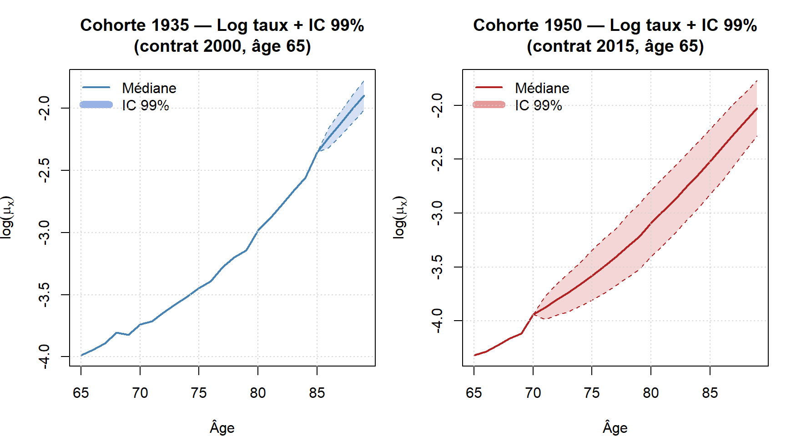
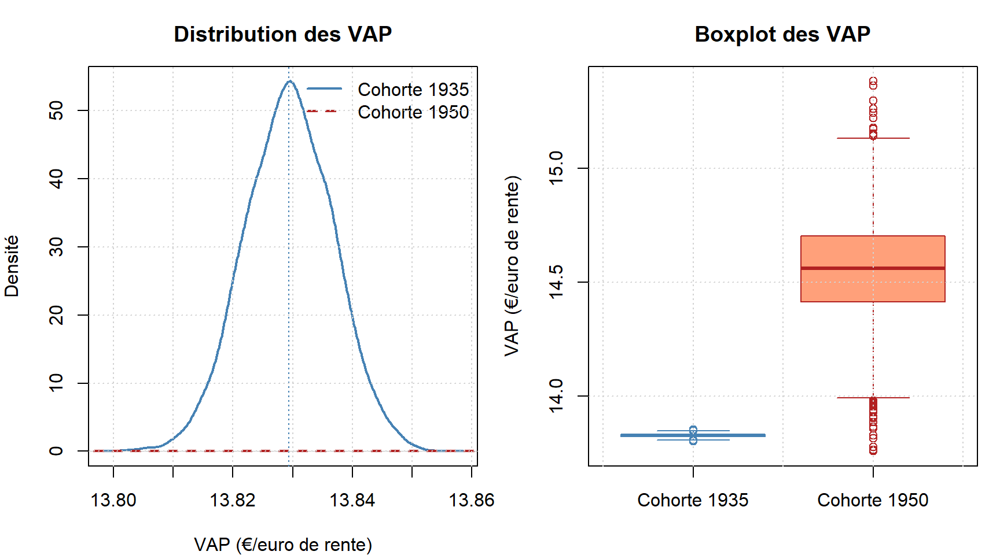

# Risque de longévité : VAP d'une rente à termes échus (Lee-Carter)

Projet d'actuariat vie (Le Mans Université / IRA et ESPRIT, 2025-2026), réalisé en groupe de 4.

## Objectif

Calculer la valeur actuelle probable (VAP) d'une rente à termes échus de 25 ans pour deux cohortes d'hommes français entrant à 65 ans :

| Cohorte | Naissance | Début du contrat | Horizon     |
|---------|-----------|------------------|-------------|
| 1       | 1935      | 2000             | 2000-2024   |
| 2       | 1950      | 2015             | 2015-2039   |

Le projet compare les deux cohortes et en déduit une tarification qui tient compte du risque de longévité.

## Méthode

- **Données** : Human Mortality Database (France, hommes, taux et expositions 1x1).
- **Modèle** : Lee-Carter, `log(mu_x,t) = a_x + b_x k_t`, estimé par maximum de vraisemblance log-Poisson (Brouhns et al., 2002) avec le package R `StMoMo`, sur les âges 60-100 et les années 1950-2020.
- **Projection** : k_t suit une marche aléatoire avec dérive ; 5 000 trajectoires simulées sur 25 ans.
- **Valorisation** : `a_x = somme_{k=1..25} v^k kp_x` avec i = 2 %, calculée pour chaque scénario.
- **Tarification** : prime pure E[VAP] et prime chargée E[VAP] + z·σ(VAP).

## Résultats principaux

| Indicateur                     | Cohorte 1935 | Cohorte 1950 |
|--------------------------------|--------------|--------------|
| VAP moyenne (pour 1 € de rente) | 13,83        | 14,56        |
| Écart-type                     | 0,0074       | 0,2139       |
| Prime pure (10 000 €/an)       | 138 294 €    | 145 558 €    |
| Prime chargée (quantile 95 %)  | 138 415 €    | 149 077 €    |

- La cohorte 1950 coûte 5,25 % de plus, parce que la longévité s'est améliorée entre les deux générations.
- Sa VAP est environ 850 fois plus variable : 19 des 25 années de son contrat sont projetées, contre 4 pour la cohorte 1935.




## Structure du dépôt

```
analyse/       code R Markdown (lee_carter_vap.Rmd) et bibliographie
rapport/       rapport final (PDF)
presentation/  support de soutenance (PDF)
figures/       graphiques produits par le code
```

## Reproduire l'analyse

1. Créer un compte gratuit sur [mortality.org](https://www.mortality.org), puis télécharger pour la France les fichiers `Mx_1x1.txt` et `Exposures_1x1.txt`. Les données HMD ne sont pas incluses dans ce dépôt, car leurs conditions d'utilisation interdisent de les redistribuer.
2. Placer les deux fichiers dans `analyse/`.
3. Installer les packages : `install.packages(c("demography", "StMoMo", "forecast", "ggplot2", "gridExtra"))`.
4. Compiler `analyse/lee_carter_vap.Rmd` (bouton Knit dans RStudio).

## Équipe et contributions

- **Yassine Selmi** : cadre théorique de la rente, formule de la VAP, calcul et tarification de la cohorte 1935, justification du taux technique.
- **Hedi Brahmi** : données HMD et ajustement Lee-Carter, cohorte 1935.
- **Imen Dridi** : estimation, intervalles de confiance et simulations, cohorte 1950.
- **Hidaya Hanafi** : VAP et tarification de la cohorte 1950, interprétation, coordination.

Encadrement : Anis Matoussi et Wissal Sabbagh.

## Limites

Le modèle de Lee-Carter ne tient pas compte des effets de cohorte. Le taux technique est fixe. Les tables nationales ne reflètent pas la sélection propre à un portefeuille d'assurés. Des modèles alternatifs (CBD, APC) permettraient de mesurer le risque de modèle.
